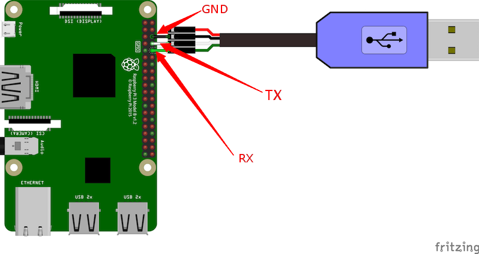

# Zephyr RTOS SMP多核处理器绑定样例

该文件夹包含样例代码和Zephyr需要的配置文件，基于Zephyr 4.5.0 RC3构建和测试。

注意：老于4.5.0版本树莓派4B的SMP支持不完整，见https://github.com/zephyrproject-rtos/zephyr/pull/114441。

样例按照宏定义的线程数创建线程，头三个线程会通过Zephyr不同的API依次与处理器核心0、1、2绑定，其余线程自由执行。每秒线程均会唤醒并打印执行的处理器核心号。树莓派4B为4核处理器，预设定义为4线程，其中线程1到3会绑定核心0到2。

## 1. 编译说明

如果没有编译过Zephyr，参考官方文档[1]进行环境设置并编译闪灯样例。

创建`zephyr/samples/boards/rpi_4b/`文件夹，将本文件夹复制到其中准备编译。

进入Zephyr Python虚拟环境后通过`west`编译：

```
cd samples/boards/rpi_4b/smp_cpu_pin_mask/
west build -p -b rpi_4b .
```

完成后`build/zephyr`文件夹会产生`zephyr.bin`，`zephyr.elf`等文件。

`-p`选项意味着进行全新编译，应用代码迭代时一般可以移除。

## 2. 环境搭建
### 2.1 准备好串口线

目前版本是使用raspi4的GPIO 14, GPIO 15来作路口输出，连线情况如下图所示[2]：



串口参数：115200 8N1，硬件和软件流控为关。

### 2.2 SD卡运行

BSP不支持树莓派直接加载运行，需要使用u-boot加载。

**1.准备SD卡**

不同样例SD卡准备只需要做一次。

参考树莓派Imager工具[3]直接格式化和准备SD卡。

查看`lsblk`输出，确定SD卡路径，如`/dev/sdb`。

卸载SD卡上已挂载的文件系统，例如`sudo umount /dev/sdb1`。

通过fdisk修改分区表，创建一个256MB的`BOOT`文件系统，其余空间创建第二个`ROOTFS`文件系统：

```
$ sudo fdisk /dev/sdb
[sudo] password for <user>: 

Welcome to fdisk (util-linux 2.39.3).
Changes will remain in memory only, until you decide to write them.
Be careful before using the write command.

This disk is currently in use - repartitioning is probably a bad idea.
It's recommended to umount all file systems, and swapoff all swap
partitions on this disk.


Command (m for help): o

Created a new DOS (MBR) disklabel with disk identifier 0x0c610a8c.
The device contains 'gpt' signature and it will be removed by a write command. See fdisk(8) man page and --wipe option for more details.

Command (m for help): n
Partition type
   p   primary (0 primary, 0 extended, 4 free)
   e   extended (container for logical partitions)
Select (default p): p
Partition number (1-4, default 1): 1
First sector (2048-62521343, default 2048): 
Last sector, +/-sectors or +/-size{K,M,G,T,P} (2048-62521343, default 62521343): +256M

Created a new partition 1 of type 'Linux' and of size 256 MiB.
Partition #1 contains a vfat signature.

Do you want to remove the signature? [Y]es/[N]o: Y

The signature will be removed by a write command.

Command (m for help): t
Selected partition 1
Hex code or alias (type L to list all): c
Changed type of partition 'Linux' to 'W95 FAT32 (LBA)'.

Command (m for help): n
Partition type
   p   primary (1 primary, 0 extended, 3 free)
   e   extended (container for logical partitions)
Select (default p): p
Partition number (2-4, default 2): 2
First sector (526336-62521343, default 526336): 
Last sector, +/-sectors or +/-size{K,M,G,T,P} (526336-62521343, default 62521343): 

Created a new partition 2 of type 'Linux' and of size 29.6 GiB.

Command (m for help): w
The partition table has been altered.
Failed to remove partition 2 from system: Device or resource busy
Failed to update system information about partition 1: Device or resource busy
Failed to add partition 2 to system: Device or resource busy

The kernel still uses the old partitions. The new table will be used at the next reboot. 
Syncing disks.
```

格式化分区：

```
sudo mkfs.vfat -F 32 -n "BOOT" /dev/sdb1
sudo mkfs.ext4 -L "ROOTFS" /dev/sdb2
```

接下来拔插SD卡，让系统自动挂载文件系统。

**2.复制树莓派文件**

`misc`文件夹下可以找到[config.txt](./misc/config.txt)文件（参考：[4])，将其复制到`BOOT`文件系统中（例如`/media/<user>/BOOT`）。

下载树莓派4B的固件文件[5]到`BOOT`文件系统中，需要的文件：`bcm2711-rpi-4-b.dtb`，`fixup4.dat`和`start4.elf`。

## 3. 运行

每次编译后，将`build/zephyr/zephyr.bin`复制到SD卡`BOOT`中。将SD卡插入树莓派背面的卡槽，上电。

运行输出样例：

```
MESS:00:00:05.099176:0:*** Booting Zephyr OS build v4.5.0-rc3 ***
Secondary CPU core 1 (MPID:0x1) is up
Secondary CPU core 2 (MPID:0x2) is up
Secondary CPU core 3 (MPID:0x3) is up
Demo for SMP CPU pinning and masking.
Thread 1 is running on core 0, count: 0
Thread 2 is running on core 1, count: 0
Thread 3 is running on core 2, count: 0
Thread 4 is running on core 0, count: 0
Thread 2 is running on core 1, count: 1
Thread 3 is running on core 2, count: 1
Thread 4 is running on core 3, count: 1
Thread 1 is running on core 0, count: 1
```

## 4. 参考链接

[1] https://docs.zephyrproject.org/latest/develop/getting_started/index.html

[2] https://github.com/RT-Thread/rt-thread/tree/master/bsp/raspberry-pi/raspi4-64#readme

[3] https://www.raspberrypi.com/software/

[4] https://docs.zephyrproject.org/latest/boards/raspberrypi/rpi_4b/doc/index.html

[5] https://github.com/raspberrypi/firmware/tree/master/boot
